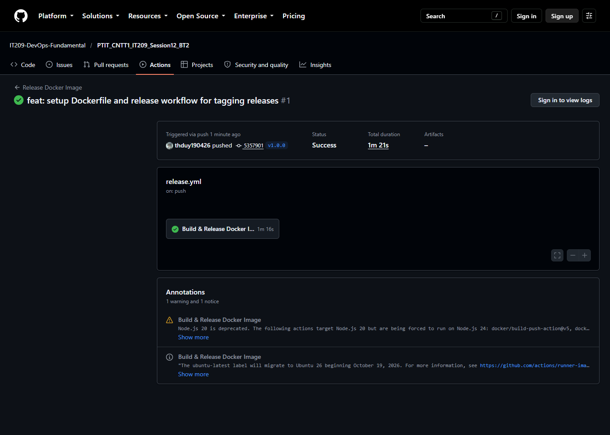
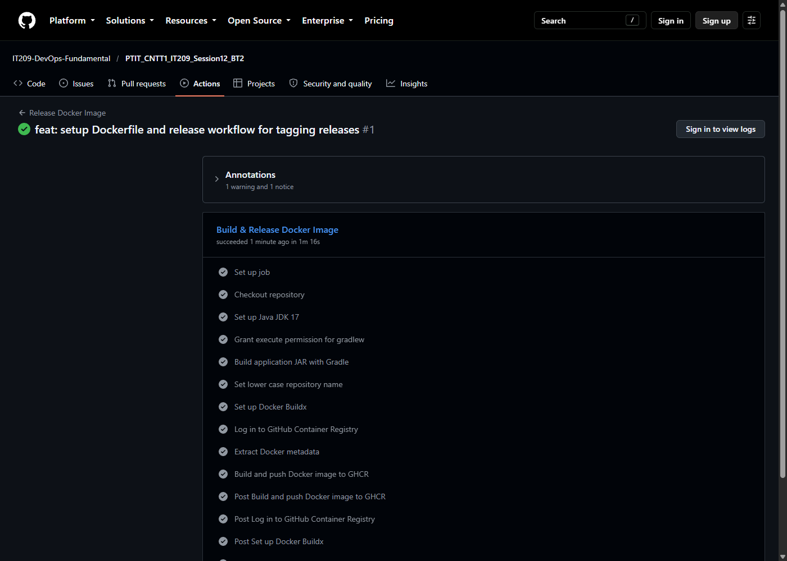
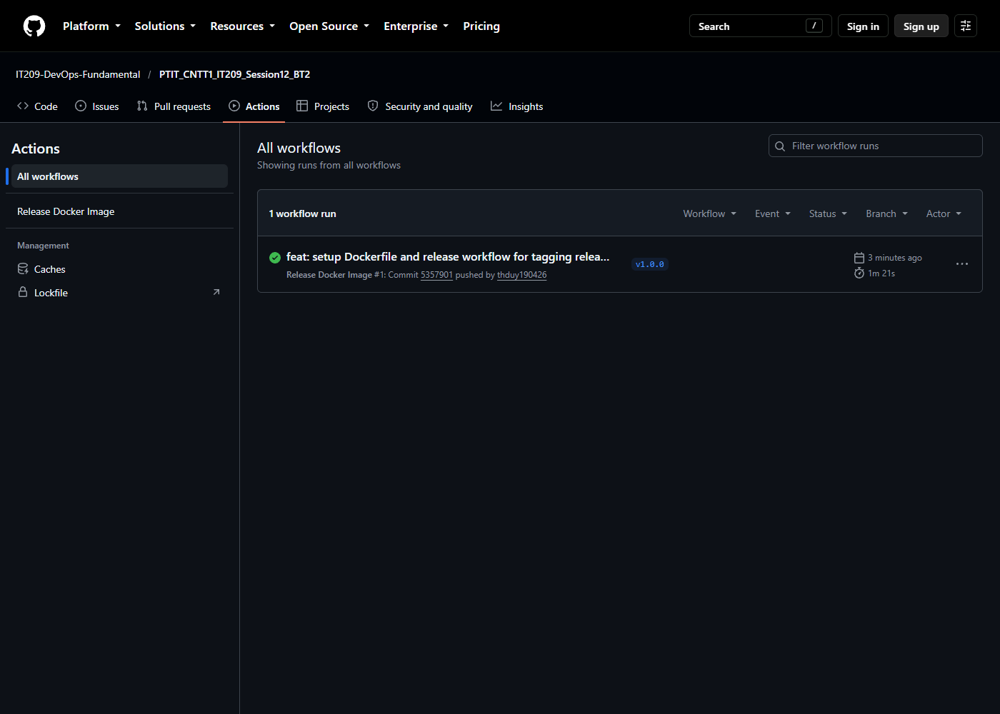

# Bài 2: Tự động hóa đóng gói và phát hành Docker Image khi gắn Git Tag (v*.*.*)

## 1. Mục tiêu
- Cấu hình luồng Continuous Delivery (CD) tự động phát hành phiên bản Docker Image chính thức khi có sự kiện gán nhãn Release (`Git Tag v*.*.*`).
- Tự động tạo và trích xuất thẻ Docker Tag tương ứng với số phiên bản Git Tag bằng action `docker/metadata-action@v5`.
- Đóng gói và đẩy Docker Image lên GitHub Container Registry (`ghcr.io`) bằng `docker/build-push-action@v5` và `docker/login-action@v3`.

## 2. Kịch bản GitHub Actions Workflow
Tệp kịch bản: [`.github/workflows/release.yml`](.github/workflows/release.yml)

```yaml
name: Release Docker Image

on:
  push:
    tags:
      - 'v*.*.*'

jobs:
  release-image:
    name: Build & Release Docker Image
    runs-on: ubuntu-latest
    permissions:
      contents: read
      packages: write

    steps:
      - name: Checkout repository
        uses: actions/checkout@v5

      - name: Set up Java JDK 17
        uses: actions/setup-java@v5
        with:
          java-version: '17'
          distribution: 'temurin'
          cache: 'gradle'

      - name: Grant execute permission for gradlew
        run: chmod +x gradlew

      - name: Build application JAR with Gradle
        run: ./gradlew bootJar

      - name: Set lower case repository name
        run: |
          echo "IMAGE_NAME=ghcr.io/${GITHUB_REPOSITORY,,}" >> $GITHUB_ENV

      - name: Set up Docker Buildx
        uses: docker/setup-buildx-action@v3

      - name: Log in to GitHub Container Registry
        uses: docker/login-action@v3
        with:
          registry: ghcr.io
          username: ${{ github.actor }}
          password: ${{ secrets.GITHUB_TOKEN }}

      - name: Extract Docker metadata
        id: meta
        uses: docker/metadata-action@v5
        with:
          images: ${{ env.IMAGE_NAME }}
          tags: |
            type=semver,pattern={{version}}
            type=semver,pattern={{major}}.{{minor}}
            type=raw,value=latest

      - name: Build and push Docker image to GHCR
        uses: docker/build-push-action@v5
        with:
          context: .
          push: true
          tags: ${{ steps.meta.outputs.tags }}
          labels: ${{ steps.meta.outputs.labels }}
```

## 3. Tệp Dockerfile
Tệp kịch bản container: [`Dockerfile`](Dockerfile)

```dockerfile
FROM eclipse-temurin:17-jre-alpine
WORKDIR /app
RUN addgroup -S appgroup && adduser -S appuser -G appgroup
COPY build/libs/*.jar app.jar
RUN chown appuser:appgroup app.jar
USER appuser
EXPOSE 8080
ENTRYPOINT ["java", "-jar", "app.jar"]
```

## 4. Kết quả kiểm tra trên GitHub Actions & GHCR
- **Repository**: [IT209-DevOps-Fundamental/PTIT_CNTT1_IT209_Session12_BT2](https://github.com/IT209-DevOps-Fundamental/PTIT_CNTT1_IT209_Session12_BT2)
- **Tag kích hoạt**: `v1.0.0`
- **Workflow Run**: [Run #1 (ID: 38551427078)](https://github.com/IT209-DevOps-Fundamental/PTIT_CNTT1_IT209_Session12_BT2/actions/runs/38551427078)
- **Trạng thái**: Tích xanh (**Success**) trong 1m 16s.
- **Docker Image được phát hành lên GHCR**:
  - `ghcr.io/it209-devops-fundamental/ptit_cntt1_it209_session12_bt2:1.0.0`
  - `ghcr.io/it209-devops-fundamental/ptit_cntt1_it209_session12_bt2:1.0`
  - `ghcr.io/it209-devops-fundamental/ptit_cntt1_it209_session12_bt2:latest`

### Ảnh chụp màn hình minh chứng:
1. **Workflow run hoàn thành tích xanh khi push Git tag v1.0.0:**


2. **Chi tiết các bước thực thi thành công trong Job `Build & Release Docker Image`:**


3. **Danh sách chạy workflow theo tag trong tab Actions:**

